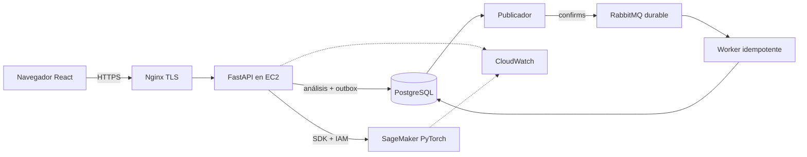
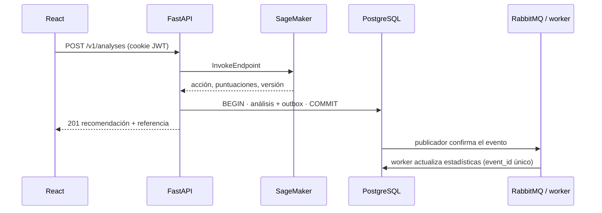
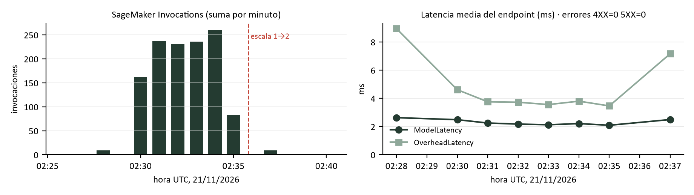

# Preflop Six Max

**Entrenador de decisiones preflop para una academia de póker, con inferencia en AWS SageMaker.**

Evaluación Parcial 3 · ITY1102 Arquitectura de Sistemas de Inteligencia Artificial · Duoc UC
Autor: Vicente Hueichapan · Entrega individual · Noviembre de 2026

PyTorch · FastAPI · React · PostgreSQL · RabbitMQ · Docker · AWS (SageMaker, EC2, S3, ECR, CloudWatch)

---

## Índice

1. [Entregables y accesos](#1-entregables-y-accesos)
2. [Caso empresarial y alcance](#2-caso-empresarial-y-alcance)
3. [Arquitectura](#3-arquitectura)
4. [Estructura del repositorio](#4-estructura-del-repositorio)
5. [Dataset y modelo](#5-dataset-y-modelo)
6. [API REST](#6-api-rest)
7. [Seguridad](#7-seguridad)
8. [Pruebas, rendimiento y evidencias](#8-pruebas-rendimiento-y-evidencias)
9. [Ejecución local](#9-ejecución-local)
10. [Despliegue en AWS](#10-despliegue-en-aws)
11. [Operación: encender y apagar SageMaker](#11-operación-encender-y-apagar-sagemaker)
12. [Costos](#12-costos)
13. [Limitaciones](#13-limitaciones)
14. [Cumplimiento de la pauta](#14-cumplimiento-de-la-pauta)
15. [Referencias y uso de IA](#15-referencias-y-uso-de-ia)

---

## 1. Entregables y accesos

| Entregable | Dónde |
|---|---|
| Informe técnico, 10 páginas: `EP3_EquipoIndividual_Hueichapan.pdf` | AVA |
| Presentación, 6 láminas: `EP3_Presentacion_EquipoIndividual_Hueichapan.pdf` | AVA |
| Repositorio: README, código, Dockerfile, datos, modelo y evidencias | Este repositorio |
| Sistema desplegado | URLs de la tabla siguiente |

| Servicio | URL |
|---|---|
| Mesa de estudio y dashboard | https://54.162.150.183/ |
| Swagger / OpenAPI | https://54.162.150.183/docs · https://54.162.150.183/openapi.json |
| Salud del proceso / dependencias | https://54.162.150.183/health/live · https://54.162.150.183/health/ready |
| Modelo | Endpoint SageMaker `ep3-preflop`, región `us-east-1`. Es privado y solo se consume mediante SDK e IAM. |

La mesa abre directamente, **sin usuario ni contraseña**: el navegador recibe una sesión invitada aislada. Las URLs funcionan mientras el laboratorio AWS Academy, la EC2 y el endpoint estén activos (ver [sección 11](#11-operación-encender-y-apagar-sagemaker)).

**Ejemplos verificados en AWS**

| Situación | Cartas | Respuesta del modelo |
|---|---|---|
| Apertura UTG | 7♠ 2♥ | Retirarse (fold) |
| Apertura BTN tras folds UTG/HJ/CO | A♠ K♥ | Subir a 2,5 BB |
| BB frente a apertura BTN de 2,5 BB | 9♠ 9♥ | Pagar 1,5 BB |

## 2. Caso empresarial y alcance

Una academia de póker necesita que sus alumnos practiquen decisiones de forma consistente y que el entrenador pueda revisarlas. El alumno arma una situación en una mesa de seis asientos, elige sus cartas y recibe la acción recomendada por un clasificador PyTorch desplegado en SageMaker. La interfaz muestra por separado la política de referencia, la regla del rango, la comparación entre posiciones y un historial con la concordancia por alumno.

- **Alcance:** cash six max, 100 BB, ciegas 0,5/1 BB y sin antes. Cinco aperturas después de folds (UTG, HJ, CO, BTN, SB) y defensa de BB frente a BTN. Tamaños: apertura 2,5 BB, SB 3 BB y resubida de BB 10 BB.
- **Fuera de alcance:** postflop, torneos/ICM, otros stacks, limps, varios callers y resubidas sucesivas.
- **No es un solver GTO.** El modelo aprende una política didáctica propia. Sus puntuaciones no son probabilidades de ganar.

## 3. Arquitectura





- **Inferencia síncrona y estadísticas asíncronas:** el alumno recibe la respuesta sin esperar al worker.
- **Outbox transaccional:** el análisis y el evento se guardan juntos. La entrega es *al menos una vez* y su efecto es idempotente por `event_id`. Hay tres reintentos y una cola de descarte.
- **El modelo está fuera del servidor web:** SageMaker escala de 1 a 2 instancias de forma independiente.
- **Falla explícita:** si SageMaker no responde, la API devuelve 503 y nunca inventa una recomendación.

Infraestructura: EC2 t3.medium (Amazon Linux 2023) con Nginx y Docker Compose (API + interfaz, PostgreSQL 17, RabbitMQ 4, publicador y worker). SageMaker ml.m5.large con imagen de inferencia propia en ECR. S3 privado y cifrado para el modelo y los datos. CloudWatch para logs (7 días) y métricas. Más detalle en [docs/ARQUITECTURA.md](docs/ARQUITECTURA.md).

## 4. Estructura del repositorio

```text
app/                 API FastAPI (main.py), inferencia, política, BD, eventos y servidor SageMaker (serve.py)
frontend/            Interfaz React + Vite (mesa, resultado, historial)
data/                policy.json (rangos), dataset.csv (1.014 filas), splits.json (particiones)
scripts/             train.py, benchmark.py, smoke_cloud.py, demo_api.ps1, collect_cloud.py, run_load.sh
tests/               test_system.py: 34 pruebas pytest
artifacts/           Modelo (weights.json, metadata.json), métricas y evidencias de pruebas y carga
infra/               cloud.py (despliegue), bootstrap.sh, renovación TLS, pausar/reanudar SageMaker
docs/                Arquitectura, accesos/evidencias y colección Postman
output/playwright/   Capturas del sistema en AWS y gráfico de CloudWatch
Dockerfile           Imagen de la API (target api) e imagen de inferencia SageMaker (target inference)
compose.yaml         Servicios de producción en la EC2
locustfile.py        Prueba de carga
```

## 5. Dataset y modelo

- **Datos:** `data/policy.json` define los rangos. El generador expande 169 manos canónicas × 6 situaciones = **1.014 registros sintéticos**. Con semilla 42, las particiones están **agrupadas por mano** (las seis situaciones de una misma mano quedan juntas): 708 de entrenamiento, 150 de validación y 156 de test.
- **Modelo:** MLP PyTorch 2.9.1 CPU 10→32→16→3 con ReLU, Adam 0,001, batch 32, máximo 400 épocas y paciencia 60. Se seleccionó la época 210 por macro F1 de validación. La versión `preflop-5b0e112653` deriva del SHA-256 de los pesos; los pesos se verifican antes de cargarse y el modelo se precarga en memoria.

| Test reservado (156) | MLP | Baseline mayoritario |
|---|---:|---:|
| Accuracy | **0,9487** | 0,8205 |
| Precision macro | 0,8804 | 0,2735 |
| Recall macro | 0,9261 | 0,3333 |
| F1 macro | **0,8979** | 0,3005 |

Matriz de confusión (fold/call/raise): `[[124,2,2],[0,7,0],[4,0,17]]`. La clase *call* tiene solo 7 casos de test. Las métricas miden concordancia con la política, no rentabilidad.

## 6. API REST

| Método y ruta | Función |
|---|---|
| `POST /v1/demo/session` | Crea o renueva la sesión invitada (cookie HttpOnly, 30 min) |
| `POST /v1/auth/token` | OAuth2 opcional para clientes REST con cuenta |
| `GET /v1/catalog` | Condiciones, seis situaciones y secuencias admitidas |
| `POST /v1/analyses` | Valida, infiere en SageMaker, persiste y emite evento → 201 |
| `GET /v1/analyses/{id}` | Análisis propio (404 si es ajeno) |
| `GET /v1/comparison?card1=As&card2=Kh` | La misma mano en las seis situaciones |
| `GET /v1/dashboard` | Historial, distribución, concordancia y eventos procesados |
| `GET /health/live` · `GET /health/ready` | Proceso · PostgreSQL + RabbitMQ + SageMaker |

Demo con curl (Windows, desde la carpeta del proyecto): crea la sesión, analiza A♠ K♥ en BTN y lee el dashboard.

```powershell
powershell -File scripts/demo_api.ps1
```

También está disponible la colección Postman: [docs/EP3_Postman.collection.json](docs/EP3_Postman.collection.json). Primero ejecuta *Preparar mesa* para obtener la cookie.

## 7. Seguridad

- **Autenticación:** JWT HS256 de 30 min en una cookie `HttpOnly`, `Secure` y `SameSite=Strict`. JavaScript nunca ve el token. Se validan firma, expiración, emisor y audiencia. Cada visitante solo ve sus propios análisis.
- **Transporte:** Nginx con TLS 1.2/1.3 y certificado Let's Encrypt, que se renueva cada 6 horas con un timer systemd. HTTP redirige a HTTPS.
- **Límites:** 120 solicitudes/min por sesión, creación de sesiones limitada por IP, cuerpo máximo de 32 KiB y rechazo de escrituras de origen cruzado.
- **Red e IAM:** PostgreSQL y RabbitMQ no tienen puertos públicos. La EC2 exige IMDSv2. SageMaker se invoca con HTTPS y firma IAM, sin claves AWS en el navegador.
- **Secretos:** `.env`, llaves y credenciales no están en el repositorio. `APP_ENV=production` rechaza SQLite, el modelo local y los eventos locales.

## 8. Pruebas, rendimiento y evidencias

| Prueba | Resultado | Evidencia |
|---|---|---|
| Unitarias e integración local (pytest) | **34/34** | `artifacts/tests-local.xml` |
| Integración real por HTTPS contra AWS | **28/28** (también 28/28 desde una red externa, 22/11/2026) | `artifacts/cloud-smoke.json` |
| Carga Locust: 5 usuarios, 5 min, HTTPS | 1.461 solicitudes · **0 errores** · 4,90 req/s · **p50/p95/p99 = 21/30/54 ms** | `artifacts/load-cloud_stats.csv` |
| CloudWatch durante la carga | 1.227 invocaciones · 0 errores 4XX/5XX · ModelLatency 2,1–2,6 ms · escalado **1→2** | `artifacts/cloud-metrics.json` |
| Optimización: modelo precargado vs. carga por petición | 0,086 ms vs. 1,348 ms (**15,7×**, CPU local) | `artifacts/optimization-local.json` |
| Recuperación tras recrear contenedores | 28/28 (se conserva la corrida previa 27/28) | `artifacts/recovery-check.json` |



La batería cubre rangos y particiones, cartas repetidas y turnos inválidos (422), sesión ausente (401), análisis ajeno (404), SageMaker caído (503), exceso de solicitudes (429), outbox, idempotencia, cookies manipuladas, origen cruzado y readiness durante el escalado.

```powershell
$env:PYTEST_DISABLE_PLUGIN_AUTOLOAD='1'
python -m pytest -q --junitxml=artifacts/tests-local.xml
python scripts/benchmark.py
$env:EVIDENCE_DIR="$env:TEMP\ep3"; python scripts/smoke_cloud.py   # 28 controles contra la URL pública
```

Capturas del sistema en AWS: [mesa](output/playwright/aws-mesa.png) · [inicio](output/playwright/aws-mesa-inicio.png) · [historial](output/playwright/aws-historial.png). El índice completo de evidencias está en [docs/ACCESOS_Y_EVIDENCIAS.md](docs/ACCESOS_Y_EVIDENCIAS.md).

*Alcance de las cifras:* la carga se generó desde la EC2 contra la URL pública, por lo que no mide la red de un alumno remoto ni el renderizado del navegador. El benchmark de precarga es local.

## 9. Ejecución local

Requisitos: Python 3.12, Node 24 y npm (no necesita GPU). En PowerShell:

```powershell
python -m venv .venv
.venv\Scripts\Activate.ps1
python -m pip install torch==2.9.1 --index-url https://download.pytorch.org/whl/cpu
python -m pip install -r requirements.txt
python scripts/setup_local.py      # genera .env local con secretos aleatorios
python scripts/train.py            # opcional: reproduce el entrenamiento
Set-Location frontend; npm ci; npm run build; Set-Location ..
python -m uvicorn app.main:create_app --factory --host 127.0.0.1 --port 8013
```

Luego abre http://127.0.0.1:8013. El modo local usa SQLite, inferencia local y eventos locales, y la interfaz lo indica. **Producción exige PostgreSQL, RabbitMQ y SageMaker.**

## 10. Despliegue en AWS

Región `us-east-1`, cuenta AWS Academy, perfil `LabInstanceProfile` y rol `LabRole`. Ejecútalo desde CloudShell con boto3:

1. `python infra/cloud.py preflight`: solo lectura; revisa los recursos existentes.
2. `python infra/cloud.py create-server`: crea la EC2, el grupo de seguridad y el bootstrap (Docker, Nginx, TLS, contenedores, imagen ECR y endpoint SageMaker con auto-scaling 1–2, objetivo de 60 invocaciones/instancia/min y cooldown de 60 s).
3. `python infra/cloud.py associate-ip`: asocia la IPv4 fija.
4. `python infra/cloud.py status`: muestra el estado de la EC2 y del endpoint.
5. Verifica `/health/ready` y ejecuta `scripts/smoke_cloud.py`.

En la EC2 (`/opt/ep3-preflop/source`): `sudo docker compose exec -T api python scripts/smoke_cloud.py`, `sudo bash scripts/run_load.sh` y `sudo /opt/ep3-preflop/tools/bin/python scripts/collect_cloud.py`.

## 11. Operación: encender y apagar SageMaker

**Un endpoint SageMaker no se puede "detener": cobra mientras existe**, aunque nadie lo use. Para dejar de pagar hay que **eliminar el endpoint** y conservar el modelo y la configuración, de modo que se pueda recrear idéntico en 5–10 minutos. Detener la EC2 **no** apaga SageMaker.

### Apagar (al terminar de practicar)

1. En AWS Academy, abre la consola de AWS y entra a **CloudShell** (icono `>_` en la barra superior, región *N. Virginia*).
2. Sube `infra/sagemaker_pausar.sh` (Actions → Upload file) o pega su contenido.
3. Ejecuta `bash sagemaker_pausar.sh`. Al final debe decir `Listo: endpoint eliminado`.
4. Opcional: detén la EC2 desde EC2 → Instances → `ep3-preflop` → *Instance state → Stop*. Mientras esté detenida, EBS y la IPv4 siguen cobrando unos centavos.

Desde la consola web, el paso 3 equivale a: SageMaker AI → Inference → **Endpoints** → `ep3-preflop` → *Delete*. **No borres** *Endpoint configurations* ni *Models*.

### Encender (antes de la demostración, al menos 20 minutos antes)

1. Inicia el laboratorio (*Start Lab*) y espera el indicador verde.
2. EC2 → Instances → `ep3-preflop` → *Instance state → Start*. Los contenedores arrancan solos y la IP no cambia.
3. En CloudShell, ejecuta `bash sagemaker_reanudar.sh`. Recrea el endpoint desde la configuración `ep3-preflop`, espera **InService** y vuelve a registrar el auto-scaling.
4. Comprueba https://54.162.150.183/health/ready: debe responder `"status":"ready"`. Luego haz un análisis en la mesa.

Desde la consola web, el paso 3 equivale a: SageMaker AI → Endpoints → *Create endpoint* → nombre `ep3-preflop` → *Use an existing endpoint configuration* → `ep3-preflop` → *Create*. Con este método no queda registrado el auto-scaling, así que conviene usar el script.

## 12. Costos

Tarifas verificadas el 20/11/2026 (us-east-1, sin Free Tier): SageMaker ml.m5.large **USD 0,115/h** por instancia y EC2 t3.medium **USD 0,0418/h**. La reserva para pruebas, ensayo y defensa (8 h de EC2, 10 horas-instancia de ML y servicios menores) se estima en **≈ USD 2,58**, con un objetivo máximo de USD 5. Es una estimación, no una factura. Mantener todo encendido un fin de semana excede el presupuesto, por eso la operación se hace por ventanas (sección 11).

## 13. Limitaciones

Los datos son sintéticos y cubren seis situaciones, sin validación de un especialista ni un estudio educativo. Una sola EC2 es un punto único de fallo: no hay alta disponibilidad y el tramo Docker interno no usa TLS. El rol `LabRole` del laboratorio es más amplio que un rol mínimo de producción. Para una operación real: roles IAM por recurso, secretos administrados, PostgreSQL y RabbitMQ administrados, TLS interno y más ejemplos de la clase *call*.

**Oportunidades de optimización:** agrupar las seis invocaciones de `/v1/comparison` en una sola, evaluar SageMaker Serverless Inference para tráfico bajo y reducir la latencia de integración (TLS, API y BD), que hoy pesa más que los 2–3 ms del modelo.

## 14. Cumplimiento de la pauta

| Requisito EP3 | Dónde está |
|---|---|
| IE1 Modelo funcional con endpoints | `app/serve.py`, `Dockerfile` (inference), endpoint `ep3-preflop` · secciones 5 y 10 |
| IE2 Consumo e interpretabilidad para decidir | Mesa: referencia, regla del rango, comparación por posición, historial · sección 2 |
| IE4 SageMaker, escalabilidad y costos | Auto-scaling 1→2 observado, Locust, costos · secciones 8 y 12 |
| IE5 Infraestructura mínima | EC2 + modelo + `data/dataset.csv` + dashboard · secciones 1 y 3 |
| IE7 APIs REST, interoperabilidad y seguridad | Swagger `/docs`, Postman, curl, JWT/TLS/límites · secciones 6 y 7 |
| IE10 Testeo funcional y de rendimiento | 34 + 28 pruebas, p50/p95/p99, throughput, errores, accuracy/precision/recall/F1 · secciones 5 y 8 |
| Evidencias: logs y métricas CloudWatch | Grupos `/ep3-preflop/app` y `/aws/sagemaker/Endpoints/ep3-preflop` · `artifacts/cloud-metrics.json` |
| README, código y Dockerfile | Este repositorio |

## 15. Referencias y uso de IA

- Amazon Web Services. (s.f.). *Deploy models for inference*. https://docs.aws.amazon.com/sagemaker/latest/dg/deploy-model.html
- Amazon Web Services. (s.f.). *Automatic scaling of Amazon SageMaker AI models*. https://docs.aws.amazon.com/sagemaker/latest/dg/endpoint-auto-scaling.html
- Amazon Web Services. (s.f.). *Delete endpoints and resources*. https://docs.aws.amazon.com/sagemaker/latest/dg/realtime-endpoints-delete-resources.html
- Amazon Web Services. (s.f.). *Amazon SageMaker AI pricing*. https://aws.amazon.com/sagemaker/ai/pricing/
- Broadcom. (s.f.). *Consumer acknowledgements and publisher confirms*. RabbitMQ. https://www.rabbitmq.com/docs/confirms
- Duoc UC. (2025). *Evaluación Parcial 3: Proyecto Integral de Despliegue y Optimización de Sistema IA Empresarial*. Material de asignatura ITY1102.

**Declaración de uso de IA.** Se utilizó Codex de OpenAI para apoyar el diseño, la programación, las pruebas y la documentación. En la revisión final se usó Claude Code (Anthropic) para auditar la entrega contra la pauta, agregar la figura de CloudWatch, mejorar el manejo de errores de la interfaz y ordenar este README. La responsabilidad académica corresponde al estudiante. Los resultados reportados provienen de ejecuciones reales y se distingue cada entorno.
