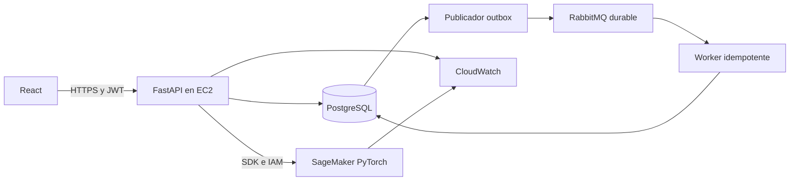

# Preflop Six Max

Entrenador académico preflop para una academia de póker. Proyecto individual ITY1102 EP3 de Vicente Hueichapan. PyTorch, FastAPI, React, PostgreSQL, RabbitMQ y AWS SageMaker.

**Demo:** https://54.162.150.183/ · **Swagger:** https://54.162.150.183/docs . Requiere laboratorio AWS y cómputo EP3 activos. Acceso demo entregado en privado, sin contraseñas en este repositorio.

El modelo aprende una política didáctica propia, versionada en JSON. No es un solver GTO, no estima probabilidades de ganar ni garantiza rentabilidad. La API obtiene su acción del clasificador real y muestra la referencia por separado.

## Alcance y ejemplos

Mesa six max: UTG, HJ, CO, BTN, SB, BB. Cash, 100 BB, ciegas 0,5/1 BB y sin antes. Solo cinco aperturas después de folds y defensa de BB frente a BTN. Apertura 2,5 BB, SB 3 BB y resubida de BB 10 BB. Fuera de alcance: postflop, torneos, ICM, otros stacks, limps, varios callers y resubidas sucesivas.

| Situación | Cartas | Resultado verificado |
|---|---|---|
| Apertura UTG | 7s 2h | Fold |
| Apertura BTN tras folds UTG/HJ/CO | As Kh | Raise a 2,5 BB |
| BB frente a BTN 2,5 BB, SB fold | 9s 9h | Call de 1,5 BB |

Las acciones deben coincidir con el catálogo. El backend calcula turno, aportes y bote y rechaza cartas repetidas o secuencias no soportadas con HTTP 422.

## Arquitectura



La transacción guarda análisis y outbox juntos. El publicador confirma entrega al broker. El consumidor confirma después del commit y deduplica por event_id. Tres intentos de procesamiento y cola de descarte. El contrato es entrega al menos una vez con efecto idempotente, no entrega exactamente una vez.

## Instalación local

Requisitos: Python 3.12, Node 24 y npm. El entrenamiento CPU funciona sin GPU. En PowerShell desde esta carpeta:

```powershell
python -m venv .venv
.venv\Scripts\Activate.ps1
python -m pip install torch==2.9.1 --index-url https://download.pytorch.org/whl/cpu
python -m pip install -r requirements.txt
python scripts/setup_local.py
python scripts/train.py
Set-Location frontend
npm ci
npm run build
Set-Location ..
python -m uvicorn app.main:create_app --factory --host 127.0.0.1 --port 8013
```

Abrir http://127.0.0.1:8013. setup_local.py genera `.env` solo si no existe. Consultar la contraseña local dentro de ese archivo privado. No copiarla a documentación ni publicar el archivo. Se incluyen pesos entrenados, por lo que entrenar otra vez es opcional para ejecutar, pero necesario para reproducir el experimento.

El modo local usa SQLite, inferencia local y procesamiento local de eventos, identificados en la interfaz. **Producción exige PostgreSQL, RabbitMQ y SageMaker** y rechaza sustituciones. Docker Compose corresponde a producción AWS y necesita un `.env` privado generado por el bootstrap, perfil IAM y acceso al endpoint.

## Dataset y modelo

`data/policy.json` contiene los rangos, `data/dataset.csv` los 1.014 registros y `data/splits.json` la separación agrupada por clase de mano. Son 169 clases por seis situaciones. Suits equivalentes y las seis situaciones de una misma clase permanecen en la misma partición: 708 entrenamiento, 150 validación, 156 test.

MLP PyTorch CPU con diez entradas, capas ocultas 32/16 y tres acciones. Adam 0,001, batch 32, semilla 42, máximo 400 épocas, paciencia 60. Se seleccionó época 210 de 270 ejecutadas. `metadata.json` registra versiones y SHA-256. Los pesos JSON se verifican antes de cargar. El servicio precarga la red y utiliza torch.inference_mode.

| Evaluación reservada | Resultado |
|---|---:|
| Accuracy | 0,9487 |
| Precision macro | 0,8804 |
| Recall macro | 0,9261 |
| F1 macro | 0,8979 |
| F1 macro baseline mayoritario | 0,3005 |

Cada clase canónica tiene el mismo peso. Las métricas no reflejan las frecuencias de combinaciones físicas de una baraja ni rendimiento estratégico real. Call tiene solo siete ejemplos de test. La comparación de referencia en la pantalla permite observar las discrepancias.

## API y seguridad

| Operación | Función |
|---|---|
| POST /v1/auth/token | Formulario OAuth2 y JWT de 30 minutos |
| GET /v1/catalog | Juego, escenarios y acciones admitidas |
| POST /v1/analyses | Inferencia, persistencia y evento |
| GET /v1/analyses/{id} | Análisis autorizado por usuario |
| GET /v1/comparison?card1=As&card2=5s | Seis inferencias sin guardar análisis |
| GET /v1/dashboard | Historial, distribución y eventos |
| GET /health/live | Estado del proceso |
| GET /health/ready | PostgreSQL, RabbitMQ y SageMaker |
| GET /docs y /openapi.json | Contrato Swagger/OpenAPI |

Contraseñas Argon2, JWT con emisor/audiencia, 120 solicitudes/minuto/usuario y límite de login por IP. Nginx usa TLS público, admite TLS 1.2/1.3, redirige HTTP y limita cuerpos a 32 KiB. EC2 exige IMDSv2. PostgreSQL y RabbitMQ permanecen en red Docker privada sin publicar puertos. El salto interno de la EC2 no usa TLS. El rol de Academy es más amplio que un rol mínimo de producción; no se modificaron sus permisos.

No hay registro público de usuarios ni fallback JSON si SageMaker falla: se responde 503. `.env`, claves, runtime y archivos privados quedan fuera de GitHub. No activar logs de cuerpos, tokens ni contraseñas.

## Pruebas y evidencias

```powershell
$env:PYTEST_DISABLE_PLUGIN_AUTOLOAD='1'
python -m pytest -q --junitxml=artifacts/tests-local.xml
python scripts/benchmark.py
```

Desactivar plugins automáticos impide que Locust modifique threading de TestClient. Se ejecutan las 26 pruebas: rangos, particiones, reglas, auth, aislamiento, errores de proveedor, límites, outbox, idempotencia y contratos.

En la **instancia EP3**, dentro de `/opt/ep3-preflop/source`:

```bash
sudo docker compose exec -T api python scripts/smoke_cloud.py
sudo bash scripts/run_load.sh
sudo /opt/ep3-preflop/tools/bin/python scripts/collect_cloud.py
```

`smoke_cloud.py` usa credenciales dentro del contenedor sin imprimirlas. Confirmó 22/22 controles reales. Locust crea cinco cuentas sintéticas, conserva límites de seguridad y ejecuta cinco usuarios durante cinco minutos. Resultado: 1.464 solicitudes, cero errores, 4,888 solicitudes/s, p50 20 ms, p95 35 ms, p99 110 ms. La prueba sale de EC2 a localhost:8000 y sí incluye SageMaker y PostgreSQL, pero **excluye Internet, TLS/Nginx y navegador**. Las cifras proceden de `artifacts/load-cloud_stats.csv`.

`artifacts/optimization-local.json` compara 100 inferencias con carga por solicitud y 100 con modelo reutilizado: 1,348 ms frente a 0,086 ms de media. Es un microbenchmark CPU local, no una reducción de latencia cloud demostrada. CloudWatch y el historial de escalado están en `artifacts/cloud-metrics.json`.

## Despliegue AWS reproducible

Región usada: us-east-1. Requiere permisos Academy para EC2/SSM, S3, ECR, CloudWatch, SageMaker, Application Auto Scaling y el perfil existente LabInstanceProfile. No contiene claves AWS. Ejecutar desde un entorno autorizado como CloudShell con boto3.

1. Clonar el repositorio y comprobar región, saldo, recursos previos y precios.
2. `python infra/cloud.py preflight`: solo lectura y manifest de recursos protegidos.
3. `python infra/cloud.py create-server`: crear recursos dedicados y bootstrap.
4. `python infra/cloud.py associate-ip`: asociar exclusivamente su IPv4 fija.
5. Consultar `python infra/cloud.py status` y logs del bootstrap por SSM.
6. Verificar health, certificado válido y pruebas de integración. No omitir errores de permisos.

El bootstrap crea contenedores y artefactos, despliega `ep3-preflop` en SageMaker y configura target tracking 1–2 instancias, objetivo 60 invocaciones/instancia/min y cooldown 60 s. El endpoint tarda minutos en estar disponible. Los nombres son exclusivos de esta entrega: no ejecutar este despliegue en una cuenta que ya tenga recursos ajenos con ese prefijo. El estado privado `infra/state.json` debe conservarse para no duplicar recursos.

Una EC2 aloja aplicación, broker y base de datos. EBS gp3 20 GB cifrado, instancia t3.medium con créditos standard, SageMaker ml.m5.large CPU. S3 bloquea acceso público y cifra AES256. El certificado de IPv4 de Let’s Encrypt usa el perfil shortlived. `infra/renewal.sh` configura renovación systemd cada seis horas. CloudWatch conserva logs siete días. Durante escalado, el endpoint puede aparecer Updating aunque siga atendiendo inferencias.

## Operación, costos y cierre

Presupuesto objetivo USD 5. Tarifas verificadas el 20/11/2026: SageMaker USD 0,115/h por instancia y EC2 USD 0,0418/h, sin Free Tier. Reserva de 8 h EC2, 10 horas-instancia ML y costos menores: aproximadamente USD 2,58 antes de contingencia. Es una estimación, no el consumo facturado. El tráfico del laboratorio y sus otros proyectos tiene presupuesto independiente.

**SageMaker cobra mientras el endpoint existe.** Detener EC2 no elimina ese cargo. EBS e IPv4 también pueden seguir cobrando. Mantener el despliegue activo todo el fin de semana excedería USD 5. Utilizar ventanas de pruebas, ensayo y defensa, revisando la facturación con su retraso habitual.

El código no borra recursos ni modifica proyectos ajenos. Para pausar se necesita autorización explícita sobre los identificadores EP3: eliminar solo el endpoint de inferencia preservando modelo/configuración/S3 y detener solo su EC2. La reanudación recrea el endpoint con su configuración existente, inicia la EC2 y verifica certificado, dependencias y recorrido. No ejecutar retiradas masivas por prefijo ni terminar instancias ajenas. El laboratorio puede expirar una sesión o detener recursos: comprobar antes de presentar.

## Limitaciones

Rangos sintéticos, seis escenarios y resultados de clasificación. No validado por un especialista estratégico ni por un estudio educativo. Una sola EC2 implica punto único de fallo y limita el backend. Se requieren roles por recurso, secretos administrados, TLS interno y alta disponibilidad para una operación empresarial real.

## Fuentes y uso de IA

- [Pauta ITY1102 EP3](docs/CUMPLIMIENTO.md), entregada al estudiante por Duoc UC (2025).
- [SageMaker: despliegue](https://docs.aws.amazon.com/sagemaker/latest/dg/deploy-model.html) y [auto scaling](https://docs.aws.amazon.com/sagemaker/latest/dg/endpoint-auto-scaling.html).
- [RabbitMQ: confirms y acknowledgements](https://www.rabbitmq.com/docs/confirms).
- [Eliminar endpoint para detener cargos](https://docs.aws.amazon.com/sagemaker/latest/dg/realtime-endpoints-delete-resources.html).

Codex apoyó diseño, programación, pruebas y documentación. El estudiante debe revisar los entregables, entender los límites y defender las decisiones. Los resultados reportados provienen de ejecuciones reales y se distingue cada entorno.
