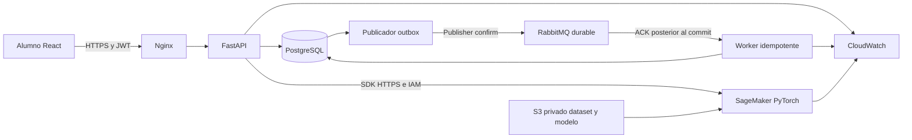
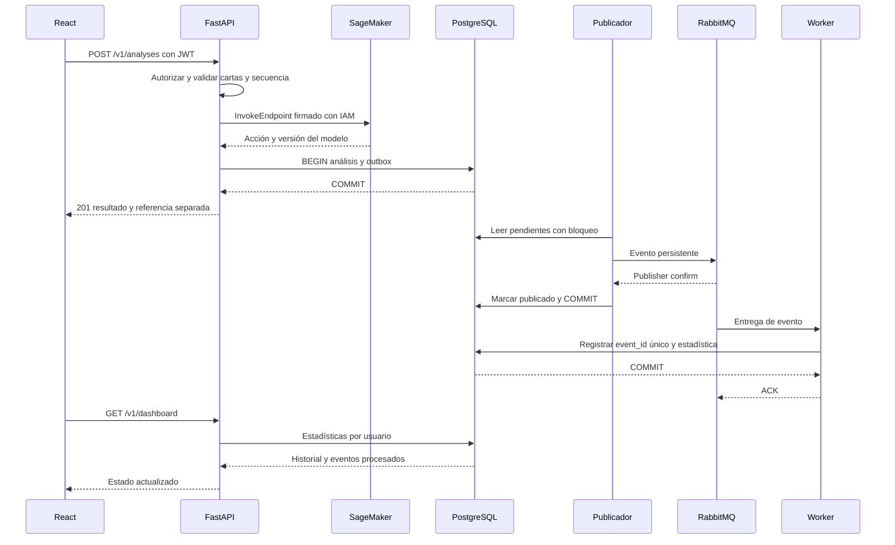

# Diagramas de arquitectura y secuencia

React, Nginx, FastAPI, PostgreSQL, RabbitMQ, publicador y worker se ejecutan en la EC2 dedicada. El backend escala de forma independiente del modelo solo en una evolución futura. SageMaker tiene target tracking 1–2 instancias. Los enlaces entre contenedores de la EC2 son privados y no usan TLS interno.

Si falla la inferencia, FastAPI devuelve 503 antes de guardar un análisis. Si falla la publicación, el outbox persiste. Una caída entre confirmación RabbitMQ y commit del publicador puede causar reentrega. El consumidor deduplica mediante event_id, por lo que el efecto en estadísticas es idempotente. Tras tres errores de procesamiento, deriva a la cola ep3-preflop.failed.
